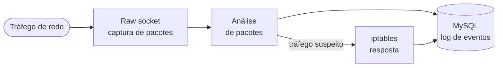
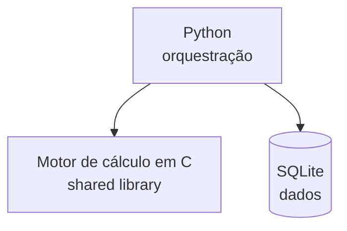
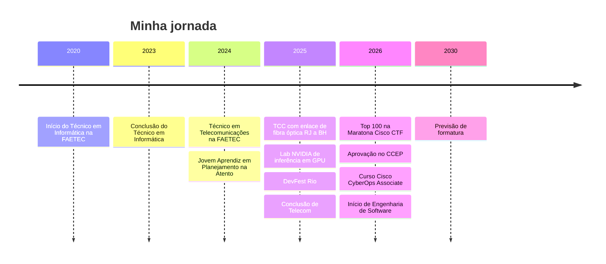

<!-- ============ CABEÇALHO ============ -->
<div align="center">


<a href="https://github.com/Azherenn">
  
</a>

<br/>

<a href="https://www.linkedin.com/in/magno-ferreira-ti/"></a>


</div>

---

## `$ whoami`

```c
#include <stdio.h>

typedef struct {
    const char *nome;
    const char *base;
    const char *foco;
    const char *cursando;
    const char *aberto_a;
} Magno;

int main(void) {
    Magno eu = {
        .nome     = "Magno (Azherenn)",
        .base     = "Rio de Janeiro, RJ",
        .foco     = "C, redes e segurança defensiva",
        .cursando = "Engenharia de Software (2026-2030)",
        .aberto_a = "estágio / Jovem Aprendiz em TI e cibersegurança",
    };

    printf("Olá, mundo! Eu sou o %s.\n", eu.nome);
    return 0;
}
```

Sou técnico em **Informática** e em **Telecomunicações** (FAETEC) e estudo **Engenharia de Software**. Gosto de entender o que acontece por baixo das abstrações: pacotes na rede, memória, sockets, sinais em fibra óptica. Hoje coloco isso em prática em projetos de segurança defensiva e de desempenho.

## 📊 Em números

| | |
|:---:|:---:|
| **1 milhão+** | registros processados no projeto Python + C |
| **~20x** | ganho de desempenho sobre Pandas/NumPy |
| **Top 100** | 12ª Maratona CiberEducação Cisco (CTF) |
| **100+** | relatórios padronizados que consolidei como Jovem Aprendiz |

## 🚀 Projetos

### 🛡️ [c-ids](https://github.com/Azherenn/c-ids) · IDS/IPS em C `em desenvolvimento`

Sistema de detecção e prevenção de intrusão feito do zero em C, para estudar redes, captura de pacotes e detecção de tráfego suspeito.

**Stack:** C · raw sockets · iptables · MySQL · GCC/Make · Linux

<details>
<summary><b>Arquitetura alvo</b></summary>



</details>

### ⚡ [High-Performance-Data-Processing](https://github.com/Azherenn/High-Performance-Data-Processing) · Python + C

Sistema em três camadas que processa e analisa mais de 1 milhão de registros. Python orquestra, o motor de cálculo em C é compilado como *shared library* e os dados ficam em SQLite. Resultado: cerca de **20x** mais rápido que a implementação nativa com Pandas/NumPy.

**Stack:** Python · C · SQLite · Pandas · NumPy

<details>
<summary><b>Arquitetura</b></summary>



</details>

### 🎮 [Hangman-Game](https://github.com/Azherenn/Hangman-Game) · Jogo da forca em C

Jogo de linha de comando feito do zero para praticar os fundamentos da linguagem e criar uma experiência interativa no terminal.

**Stack:** C

### 📡 TCC de Telecomunicações · Enlace de fibra óptica RJ ↔ BH

Dimensionamento de um enlace óptico de longa distância entre Rio de Janeiro e Belo Horizonte, com orçamento de potência e balanço de perdas para validar a viabilidade da rede. Automatizei em Excel as análises de atenuação e dispersão.

## 🛠️ Tecnologias

**Linguagens e dados**<br/>


-CC342D?style=flat-square&logo=ruby&logoColor=white)


**Segurança e redes**<br/>


**Ferramentas**<br/>


**IA e computação em GPU**<br/>


**Idiomas:** Português (nativo) · Inglês (B1)

## 🧭 Trajetória



## 🎓 Formação e certificações

| | |
|---|---|
| 🎓 **Engenharia de Software** | Gran Faculdade · 2026 a 2030 (previsão) |
| 📡 **Técnico em Telecomunicações** | FAETEC, Escola Técnica Ferreira Viana · 2024 a 2025 |
| 💻 **Técnico em Informática** | FAETEC, Escola Técnica Rezende de Rammel · 2020 a 2023 |
| 🔐 **CCEP** | Certified Cybersecurity Educator Professional, Red Team Leaders · 04/2026 |
| 🛡️ **Cisco CyberOps Associate** | Curso concluído · 06/2026 (e curso Cisco Ethical Hacker) |
| 🏆 **Maratona CiberEducação Cisco** | 12ª edição, CTF · Top 100 individual |
| ⚙️ **NVIDIA** | Lab de inferência de IA em GPU com PyTorch (Tesla T4) · 11/2025 |
| 🤖 **Alura** | Trilha de IA Generativa · 20 de 30 cursos |

## 📚 Estudando agora

- C com foco em resolução de problemas e estruturas de dados
- Evolução do **c-ids**
- Python, Ruby e IA generativa (LangChain/RAG, Hugging Face)

## 📫 Vamos conversar?

Estou buscando estágio ou vaga de Jovem Aprendiz em TI, com foco em cibersegurança.

<div align="center">

<a href="https://www.linkedin.com/in/magno-ferreira-ti/"></a>

<br/><br/>

<i>Construindo software confiável, uma camada de cada vez.</i>


</div>
