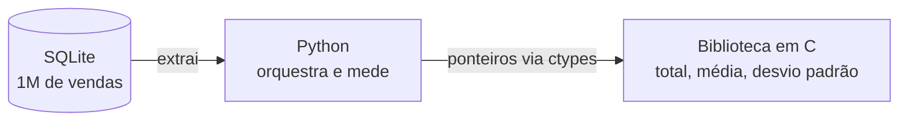
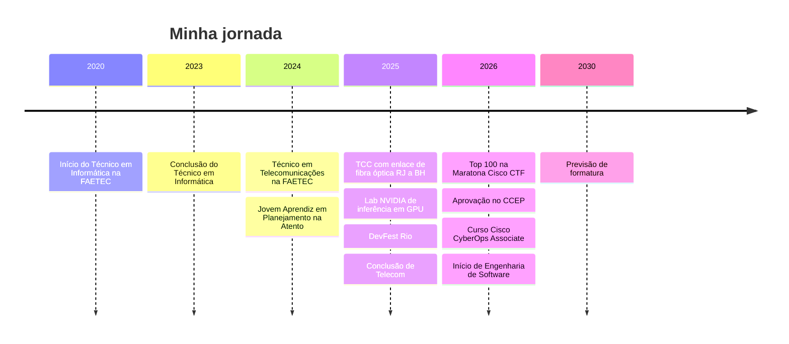

<!-- ============ CABEÇALHO ============ -->
<div align="center">


<a href="https://github.com/Azherenn">
  
</a>

<br/>

<a href="https://www.linkedin.com/in/magno-ferreira-ti/"></a>


</div>

---

## `$ whoami`

```c
#include <stdio.h>

typedef struct {
    const char *nome;
    const char *base;
    const char *formacao;
    const char *foco;
    const char *estudando;
    const char *aberto_a;
} Magno;

int main(void) {
    Magno eu = {
        .nome      = "Magno (Azherenn)",
        .base      = "Rio de Janeiro, RJ",
        .formacao  = "Técnico em Informática e Telecom + Engenharia de Software",
        .foco      = "C, redes e segurança defensiva",
        .estudando = "ponteiros, tráfego de rede e IA generativa",
        .aberto_a  = "estágio / Jovem Aprendiz em TI e cibersegurança",
    };

    printf("Olá, mundo! Eu sou o %s.\n", eu.nome);
    return 0;
}
```

Minha história começou na **camada física**: no técnico de Telecom eu calculava perdas de sinal em fibra óptica. Depois fui subindo, para redes, programação e segurança. Hoje o que me move é entender **o que acontece por baixo das abstrações**, desde o sinal no cabo até o pacote que chega ao servidor, e usar isso para **defender redes**.

## 📊 Em números

| | |
|:---:|:---|
| **1 milhão+** | de registros de vendas processados no [Sales Performance Analyzer](https://github.com/Azherenn/High-Performance-Data-Processing) (Python + C) |
| **~20x** | mais rápido que Pandas no cálculo estatístico desse mesmo projeto |
| **Top 100** | na 12ª Maratona CiberEducação Cisco (CTF) |
| **100+** | relatórios padronizados que consolidei como Jovem Aprendiz na Atento |

## 🚀 Projetos

### 🛡️ [c-ids](https://github.com/Azherenn/c-ids) · IDS/IPS em C `em desenvolvimento`

Sistema de detecção e prevenção de intrusão feito do zero em C, para entender de verdade como captura de pacotes e detecção de tráfego suspeito funcionam, em vez de usar o Snort ou o Suricata como caixa-preta. É o **primeiro de cinco projetos** do meu roadmap blue team: IDS → Honeypot → Integração → Análise de TLS → EDR com eBPF.

Hoje estou nos fundamentos que vêm antes do parser de pacotes: manipulação de bytes, layout de memória e aritmética de ponteiros.

**Stack:** C · raw sockets · iptables · MySQL · GCC/Make · Linux

<details>
<summary><b>Arquitetura alvo</b></summary>


</details>

### ⚡ [Sales Performance Analyzer](https://github.com/Azherenn/High-Performance-Data-Processing) · Python + C

Feito em dupla com o Ricardo. Python é ótimo para gerenciar dados e lento em matemática pesada, então a conta fica numa biblioteca compartilhada em C, chamada pelo Python via `ctypes`. Processa **1 milhão de vendas** guardadas em SQLite e calcula total, média e desvio padrão em **1,6 ms**, contra 33,7 ms do Pandas (**~20x**).

**Stack:** Python · C · SQLite · ctypes · Pandas · NumPy

<details>
<summary><b>Arquitetura</b></summary>



</details>

### 🎮 [Hangman-Game](https://github.com/Azherenn/Hangman-Game) · Jogo da forca em C

Jogo de terminal que roda em Windows e Linux (detecta o sistema com `#ifdef`), lê palavras, dicas e níveis de um arquivo externo e desenha a forca em ASCII. Foi onde pratiquei structs, ponteiros e leitura de arquivos.

**Stack:** C

### 📡 TCC de Telecomunicações · Enlace de fibra óptica RJ ↔ BH

Dimensionamento de um enlace óptico de longa distância entre Rio de Janeiro e Belo Horizonte, com orçamento de potência e balanço de perdas para validar a viabilidade da rede. Automatizei em Excel as análises de atenuação e dispersão.

## 🛠️ Tecnologias

**Linguagens e dados**<br/>


-CC342D?style=flat-square&logo=ruby&logoColor=white)


**Segurança e redes**<br/>


**Ferramentas**<br/>


**IA e computação em GPU**<br/>


**Idiomas:** Português (nativo) · Inglês (B1)

## 🧭 Trajetória



## 🏆 Certificações e conquistas

- 🔐 **CCEP**: Certified Cybersecurity Educator Professional, Red Team Leaders (04/2026)
- 🛡️ **Cisco CyberOps Associate** (curso concluído, 06/2026) e **Cisco Ethical Hacker** (curso)
- 🥇 **Top 100** individual na 12ª Maratona CiberEducação Cisco (CTF)

## 📚 Estudando agora

- 💻 **C**: ponteiros, memória dinâmica e estruturas de dados, com exercícios todos os dias
- 🛡️ **c-ids**: fundamentos de bytes e memória antes do parser de pacotes
- 🛰️ **Cisco**: próximo passo da trilha, do CyberOps Associate rumo ao Professional
- 🤖 **IA generativa** (trilha da Alura): `▰▰▰▰▰▰▱▱▱▱` 20 de 30 cursos, com LangChain/RAG, Hugging Face e n8n
- ⚙️ **Inferência em GPU**: lab da NVIDIA com PyTorch (Tesla T4) concluído em 11/2025
- 💎 **Ruby**: primeiros passos

## 📫 Vamos conversar?

Estou buscando estágio ou vaga de Jovem Aprendiz em TI, com foco em cibersegurança. Se você trabalha com redes, segurança defensiva ou C, vou gostar de trocar uma ideia.

<div align="center">

<a href="https://www.linkedin.com/in/magno-ferreira-ti/"></a>

<br/><br/>

<i>Construindo software confiável, uma camada de cada vez.</i>


</div>
